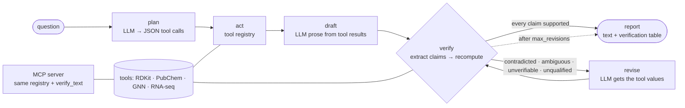
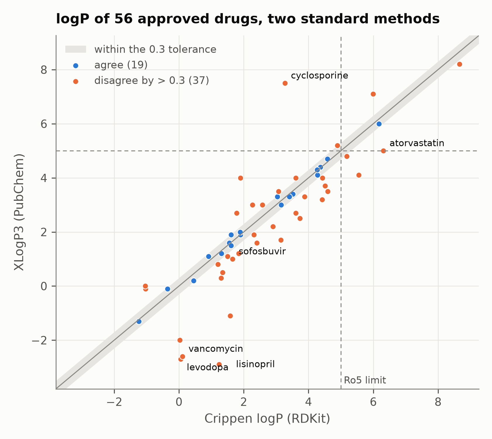
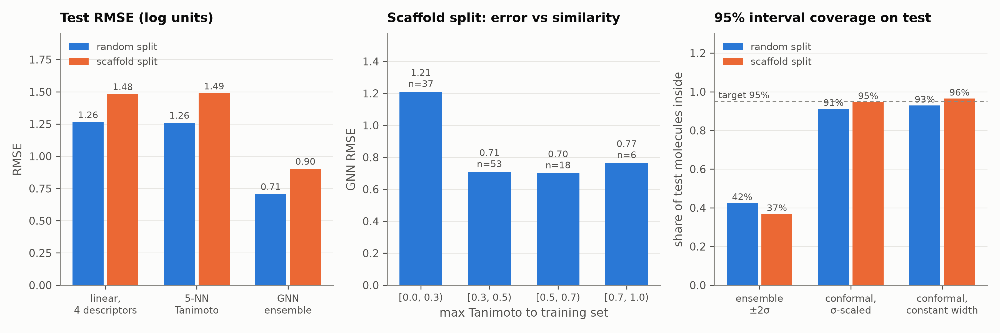
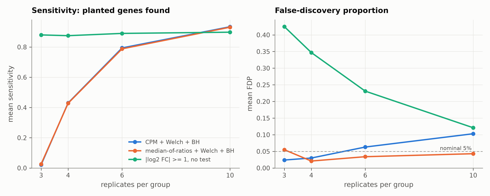
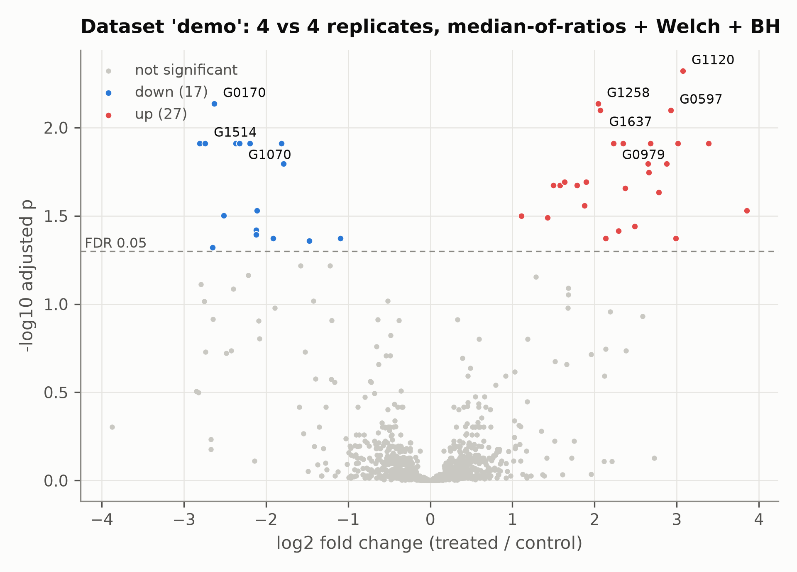

# DrugDiscovery-Agent-Lab


**A drug-discovery agent that checks its own science. The LLM plans tool calls and writes the prose; every number it states is recomputed by a deterministic tool before it reaches the reader, and whatever still fails is marked where it stands.**

> LangGraph orchestration · an MCP tool server · RDKit cheminformatics on 56 approved drugs · a message-passing GNN for solubility with conformal intervals and an applicability domain · RNA-seq differential expression on planted truth · a no-network Docker sandbox for model-written code. It all runs on a laptop CPU with a local llama3.1:8b: no API key, and no data leaves the machine.

**Measured (E5):** asked about 32 approved drugs from memory, llama3.1:8b got **75%** of the numbers it stated wrong, and every one of the 32 reports contained at least one. Given the tools, it got none wrong; with the verifier loop on top, every number in every report was checked and none was wrong, ambiguous or unsourced. A first version of the verifier with an extraction blind spot made the loop *worse* than no loop — which is why the verifier has an experiment of its own (E4).

**Environment**: Python 3.10+ · RDKit · LangGraph · MCP Python SDK 2.x · PyTorch (CPU) · NumPy/SciPy · Ollama for the experiments · Docker for the sandbox.

---

## The idea

An agent for science rarely fails by not answering. It fails by answering fluently with a number that is wrong, and in drug discovery a wrong logP, a wrong acceptor count or a wrong p-value is an input to a decision. Asked about warfarin from memory, llama3.1:8b gave a TPSA of 124.5 Ų (it is 67.5), four H-bond donors (one) and seven rotatable bonds (four), and concluded that warfarin fails the Rule of Five "as its molecular weight is above 500 g/mol" — five sentences after stating that it is 308.4.

The rule this repo is built on is the one from [AI-Review-Board-LangGraph](https://github.com/Sophia-Min12/AI-Review-Board-LangGraph): **the LLM proposes, code decides.** The verifier never asks another model whether a claim is right. It extracts the claim, recomputes it with a tool, and returns one of five verdicts. The revision prompt hands the recomputed values back to the model; whatever is still wrong after the last revision is marked inline in the report, never shipped silently.

And before any of that: **"right" is not one number.** Crippen and XLogP3 disagree by more than 0.3 log units on 37 of the 56 drugs here; atorvastatin passes the Rule of Five under one and fails it under the other (E1). A claim that does not say which method it means cannot be checked, so the verifier says *ambiguous* instead of guessing.

## Architecture



| component | file | what it does |
|---|---|---|
| chemistry | [`chem.py`](drugagent/chem.py), [`drugs.py`](drugagent/drugs.py) | RDKit descriptors, Rule of Five, Veber, PAINS/Brenk alerts, Morgan similarity, Murcko scaffolds. **Every method-dependent value is keyed by its method**, RDKit's next to PubChem's. |
| claims & verdicts | [`claims.py`](drugagent/claims.py) | A claim is subject, property, value, method, optional interval. Tolerances are per property; p-values compare on a log scale. |
| extractor | [`extract.py`](drugagent/extract.py) | Free text → claims, rule-based on purpose: a regex's misses can be counted, an LLM extractor's would need checking too. Rule thresholds ("MW under 500") are not claims; numbers no claim covers are reported as *unattributed*. |
| verifier | [`verifier.py`](drugagent/verifier.py) | Claims → verdicts by recomputation. Evidence sources for chemistry, the GNN and RNA-seq plug in. |
| agent | [`agent.py`](drugagent/agent.py) | LangGraph `StateGraph`: plan → act → draft → verify ⇄ revise → report. A plan that does not parse falls back to a fixed tool set; an unknown tool is dropped. |
| GNN | [`gnn/`](drugagent/gnn) | Message passing in plain PyTorch (`index_add_` over an edge list, no graph library), 5-model ensemble, split-conformal 95% interval, nearest-training-molecule similarity. |
| RNA-seq | [`omics.py`](drugagent/omics.py) | Negative-binomial counts with planted differentially expressed genes; median-of-ratios normalisation, Welch t-test, Benjamini-Hochberg; volcano plot. |
| tools | [`tools.py`](drugagent/tools.py) | One registry, used by the graph and by the MCP server. Bad input comes back as a readable error, never a crash. |
| MCP | [`mcp_server.py`](drugagent/mcp_server.py) | The registry over MCP, plus `verify_text`: any client can check its own draft. |
| sandbox | [`sandbox.py`](drugagent/sandbox.py) | Runs model-written code in Docker with `--network none`, a read-only root, no capabilities, user `nobody`, memory/CPU/pid/time caps. |
| LLM | [`llm.py`](drugagent/llm.py) | `OllamaLLM` (local, greedy, seeded) and `ScriptedLLM` (every test). Another provider is one class with a `complete` method. |

## Five verdicts

| verdict | meaning | example |
|---|---|---|
| **supported** | matches every accepted method within tolerance | "aspirin, MW 180.16" |
| **contradicted** | matches no accepted method | "ibuprofen, TPSA 83.6" (37.3 by every method) |
| **ambiguous** | true under one method, false under another, and the claim did not say which | "ibuprofen, logP 3.5": XLogP3 yes, Crippen (3.07) no |
| **unverifiable** | no tool here can compute it | "half-life 2 hours", "MLogP 3.97" |
| **unqualified** | a model prediction stated without its uncertainty | "predicted logS −3.1" with no interval |

---

## Experiments

Every number below is in a file under [`experiments/results/`](experiments/results), written by the script named in its heading.

### E1 · "The logP" is not one number — [`e1_provenance.py`](experiments/e1_provenance.py)

Every method this repo can compute or look up, for each of 56 approved drugs:

| property | methods | drugs where methods disagree beyond tolerance | worst case |
|---|---|---|---|
| MW | RDKit, PubChem | **0** / 56 | vancomycin, 0.07 Da |
| logP | Crippen (RDKit), XLogP3 (PubChem) | **37** / 56 (> 0.3) | cyclosporine: 3.27 vs 7.50 |
| TPSA | Ertl N,O · Ertl N,O,S,P · PubChem | **15** / 56 (> 1 Ų) | amoxicillin: 133.0 vs 158.3 |
| H-bond donors | Lipinski · RDKit · PubChem | **11** / 56 | metformin: 5 vs 3 |
| H-bond acceptors | Lipinski · RDKit · PubChem | **39** / 56 | cyclosporine: 23 vs 12 |
| rotatable bonds | RDKit · PubChem | **12** / 56 | paclitaxel: 10 vs 14 |

The Rule-of-Five verdict itself depends on the method for **atorvastatin** (Crippen logP 6.31 → two violations, fails; XLogP3 5.0 → one, passes) and **sofosbuvir** (MW is over 500 either way; Lipinski's N+O acceptor count and PubChem's put it over 10 for a second violation, RDKit's does not).

<p align="center"></p>

### E2 · A prediction is a claim with an interval — [`gnn/train.py`](drugagent/gnn/train.py)

ESOL, 1,128 molecules, measured log solubility. Random 80/10/10 split vs Bemis-Murcko scaffold split (no test scaffold appears in training):

| test RMSE (log mol/L) | random split | scaffold split |
|---|---|---|
| predict the training mean | 2.14 | 2.29 |
| linear, Delaney's 4 descriptors | 1.27 | 1.48 |
| 5-NN, Tanimoto on Morgan FPs | 1.26 | 1.49 |
| **GNN, 5-model ensemble** | **0.71** (R² 0.89) | **0.90** (R² 0.80) |

- **The random split flatters the model:** on unseen scaffolds its RMSE is 28% higher. It is still clearly the best of the four.
- **Error is 1.7× higher out of domain.** On the scaffold split, test molecules whose nearest training neighbour has Tanimoto < 0.3 (37 of 114) have RMSE 1.21; every other similarity band is 0.70–0.77. The ensemble's spread barely notices (mean σ 0.26 against 0.15–0.20; Spearman between σ and |error| 0.24).
- **The ensemble's ±2σ covers 37% of test molecules, not 95%.** A split-conformal factor calibrated on the validation scaffolds (σ × 10.5) covers 94.7%. That interval and the nearest-neighbour similarity are what the `predict_solubility` tool returns, and the verifier rejects a solubility claim that drops the interval.

<p align="center"></p>

### E3 · Code that runs, plots, and is wrong — [`e3_omics_fdr.py`](experiments/e3_omics_fdr.py)

Simulated RNA-seq, 2,000 genes of which 100 are truly changed, 20 seeds per design. The analysis a quickly written script does — CPM normalisation, Welch t-test, Benjamini-Hochberg at 5% — produces a clean volcano plot and passes every check that does not know the truth:

| replicates per group | 3 | 4 | 6 | 10 |
|---|---|---|---|---|
| sensitivity, either normalisation + Welch + BH | 0.02 | 0.43 | 0.79 | 0.93 |
| false-discovery proportion, **CPM** | 0.02 | 0.03 | 0.06 | **0.10** |
| false-discovery proportion, **median-of-ratios** | 0.06 | 0.02 | 0.03 | **0.04** |
| false-discovery proportion, **fold change ≥ 2, no test** | 0.43 | 0.35 | 0.23 | 0.12 |

Calling everything with a two-fold change finds 88–90% of the planted genes at every design, and buys it with up to 43% false discoveries.

On one dataset (the agent's `large_n10`) CPM's false-discovery proportion is **32%**, and all 44 false discoveries point down: a few strongly induced genes eat library share and push every other gene's CPM below its true level. DESeq2's median-of-ratios size factors bring it to 4.2% at the same sensitivity, so that is the default. With three replicates, Welch's test finds 2 of 100 planted genes — a design problem no analysis code fixes.

<p align="center"></p>
<p align="center"></p>

### E4 · Who checks the checker — [`e4_planted_errors.py`](experiments/e4_planted_errors.py)

224 sentences written from the tool values in four phrasings, one value per sentence perturbed by a known amount, then run through the agent's own extractor and verifier:

| planted error | caught (contradicted) |
|---|---|
| continuous, 0.5 × tolerance | 0 / 28 — by design, below tolerance is "right" |
| continuous, 2 × / 5 × / 20 × tolerance | **93 / 93** |
| count off by 1 or 2 | **100 / 103** |

- Extraction recall on these sentences is 100% (LLM prose is harder; E5 audits it).
- The 3 missed count errors are all in the phrasing that names no method, and in each the wrong count happens to equal *another* method's correct count — an error masked by a legitimate alternative.
- Of 784 correct claims that name their method, **0** are flagged. Of 280 correct claims that do not, 93 (33%) come back *ambiguous*: the price of leaving the method out.
- The first run of this experiment reported 18 false alarms. All 18 were the template's: it wrote Lipinski's donor count and labelled it RDKit's. The verifier was right, and the case is now a regression test.

### E5 · What reaches the reader — [`e5_agent_vs_closed_book.py`](experiments/e5_agent_vs_closed_book.py)

32 approved drugs (a seeded draw from the table), one question — *summarise the drug-likeness of X: MW, logP, TPSA, H-bond donors and acceptors, rotatable bonds, Rule of Five* — llama3.1:8b on a laptop CPU with greedy decoding, four conditions. Every final answer is scored by the same extractor and verifier.

| condition | numbers stated | wrong | reports with a wrong number | asked properties stated correctly | LLM calls per report |
|---|---|---|---|---|---|
| closed book | 216 | **162 (75%)** | 32 / 32 | 24% | 1.0 |
| closed book + verifier loop | 263 | 6 (2.3%), each marked inline | 6 / 32 | 93% | 2.7 |
| tools | 305 | 0 | 0 / 32 | 100% | 2.0 |
| **tools + verifier loop** | 298 | **0**, and 0 ambiguous, 0 unsourced | 0 / 32 | 100% | 2.2 |

- **From memory, almost every property is wrong somewhere:** TPSA in 32 of 32 reports, rotatable bonds in 29, donors in 27, logP and acceptors in 22 each, molecular weight in 14. The Rule-of-Five verdict is wrong in at least 24 of 32 — the model says "fails" for drugs that pass under every method, because it believes the TPSA above 140 that it just invented.
- **75% is a lower bound.** Nine closed-book verdicts said "fails to meet the criteria", a phrasing the extractor does not know, so they were never scored. Checked by hand, all nine are wrong.
- **Tools do most of the work.** Given tool results, the model transcribed all 305 numbers correctly. On top of that the verifier revised 5 of 32 reports — to name a method or to attach a value the extractor could not place — for 0.16 extra LLM calls per report. What it adds is not a lower error rate but a different kind of report: one in which every number has been checked. And when the model answers without tools it is the safety net — 75% wrong becomes 2.3%, and the six that survive two revisions are marked where they stand.
- **A verifier with a blind spot makes the loop worse than no loop.** In the first run the extractor read only the first value of "306.24 (RDKit) and 306.2 (PubChem)" and missed methods named in words ("according to Crippen and Lipinski"). Correct values came back as unsourced, the revision prompt told the model to remove them, and on atorvastatin the second revision invented a wrong verdict. Re-scored, that run's verified condition ended with 3 of 60 claims wrong against 0 of 73 for tools alone. The run is kept ([`e5_runs_v1_before_extractor_fix.jsonl`](experiments/results/e5_runs_v1_before_extractor_fix.jsonl)); the sentences are regression tests; the table above is the rerun.
- **Extraction audit of this run.** In the tools condition 7 values were misread: a nested list ("10 (Lipinski, 7 (RDKit), and 8 (PubChem))"), "but 5 (RDKit)", and "FSP3", a property the extractor has no key for. None is a wrong number, and each was flagged as unsourced or ambiguous rather than passed. They are left unfixed so that this run was produced and scored by the same code.
- Seconds per report are not a fair cost measure here: the four conditions share prompt prefixes and Ollama reuses its cache between them. LLM calls are.

---

## Run it

```bash
python -m venv .venv && source .venv/bin/activate          # Windows: .venv\Scripts\activate
pip install torch --index-url https://download.pytorch.org/whl/cpu
pip install -e ".[mcp,dev]"
pytest -q                                                   # Docker tests skip without the sandbox image
```

```bash
python -m drugagent tools
python -m drugagent verify "Ibuprofen has a TPSA of 83.6 and a molecular weight of 206.28."
python -m drugagent ask "Summarise the drug-likeness of imatinib."   # needs `ollama pull llama3.1:8b`
python -m drugagent.gnn.train                                         # retrain the GNN, rewrite E2
```

**As an MCP server** (Claude Code, Claude Desktop, any MCP client):

```bash
claude mcp add drugagent -- python -m drugagent.mcp_server
```

```json
{ "mcpServers": { "drugagent": { "command": "docker", "args": ["run", "-i", "--rm", "drugagent"] } } }
```

**With Docker**:

```bash
docker build -t drugagent .                                        # tools + verifier + MCP server
docker build -t drugagent-sandbox -f docker/sandbox.Dockerfile docker   # the code sandbox image
docker run --rm drugagent python -m drugagent verify "Aspirin has a TPSA of 83.6."
python -m drugagent sandbox my_analysis.py --backend docker
```

On a machine whose GPU backend misbehaves under Ollama, `OLLAMA_NUM_GPU=0` forces CPU inference.

## ⚠️ What this repo is not

- **Not a validated tool for decisions.** It checks what its tools compute. A claim about a property no tool here computes (half-life, IC50, toxicity) is *unverifiable*, not true.
- **The verifier is only as right as the tools.** "Supported" means "agrees with RDKit/PubChem", not "agrees with the measurement".
- **The extractor is regular expressions.** It is tested on the phrasings in `tests/` and audited on E5's output; a phrasing it does not know is a missed claim, and a missed claim is never checked.
- **The RNA-seq data are simulated**, by design: only simulated data know which discoveries are false. Real counts have batch effects, outliers and dependence this generator does not model.
- **ESOL is small and old.** 1,128 molecules; the scaffold split leaves 114 test molecules, so every RMSE above has an error bar of a few hundredths.
- **The LLM is an 8-billion-parameter model on a CPU**, chosen so everything runs locally. A larger model makes fewer errors; the verifier's job does not change.

## Layout

```
drugagent/          the package (see the table above)
experiments/        E1-E5 scripts; results/ holds every number in this README
tests/              pytest; closed-form answers, planted truth, scripted LLM
data/               PubChem reference table (ESOL is downloaded to data/cache/)
models/esol_gnn/    the deployed solubility ensemble and its conformal factor
docker/             the sandbox image
docs/figures/       PNG + SVG for every figure
```

## Conventions

- A value that depends on a method is never stored or returned without its method's name.
- Randomness is seeded; every number in this README is reproducible from the scripts.
- Tests check against answers known independently of the code: atomic masses, Ertl's fragment contributions, a hand-computed BH correction, the generator's planted genes, invariances a GNN must have.

## Sibling labs

- [AI-Review-Board-LangGraph](https://github.com/Sophia-Min12/AI-Review-Board-LangGraph) — the same rule for document scoring: the LLM proposes a score, deterministic rules cap it.
- [HealthAI-Lab](https://github.com/Sophia-Min12/HealthAI-Lab) — "traceable is not correct": groundedness checks on clinical RAG.
- [RAG-Lab](https://github.com/Sophia-Min12/RAG-Lab) — retrieval, reranking, and the evaluation that decides whether any of it helped.

## License

[MIT](LICENSE) © Sophia Min
